<p align="center">
  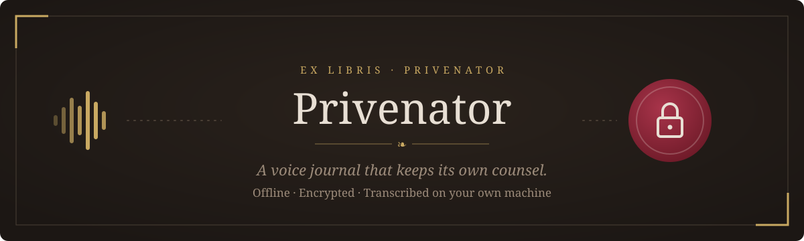
</p>

<p align="center">
  <a href="https://github.com/Sodaguyprime/privenator/releases/latest"></a>
</p>

<p align="center">
  
  
  
  
</p>

**Privenator is a journal you talk to.** Press record and speak for as long as you like. Your words are transcribed **on your own computer** as you go, then sealed into an encrypted journal that only your password opens. There are no accounts, no cloud and no network access at all.

<p align="center">
  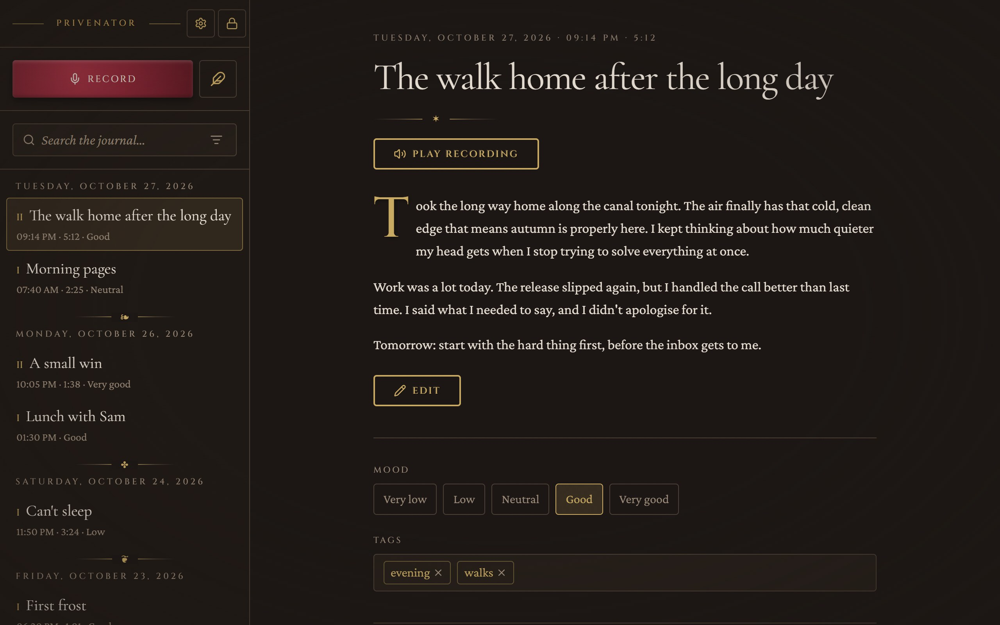
</p>

> [!NOTE]
> **Voice processing is a work in progress.** The speech-to-text currently uses Whisper's small English-only model (`base.en`) with a simple pause detector. It works, but it isn't the best it can be yet: expect the odd misheard word, weaker results with accents or background noise, and a slower live transcript on older computers. You can edit any transcript afterwards, and the original is always kept. **I'm actively working on better voice processing.**

## Contents

- [Features](#features)
- [Download and install](#download-and-install)
- [A tour](#a-tour)
- [How it works](#how-it-works)
- [Privacy and security](#privacy-and-security)
- [Status and roadmap](#status-and-roadmap)
- [Build from source](#build-from-source)
- [Documentation](#documentation)

## Features

|  |  |
| --- | --- |
| 🎙️ **Live transcription** | Text appears a moment after you speak. Pause and resume whenever you like. |
| 🔒 **Encrypted at rest** | Entries, audio, tags and the search index sit in an encrypted database. Nothing is ever written to disk in plain text. |
| 📴 **Fully offline** | The speech model ships inside the installer. The app never connects to the internet. |
| 🕰️ **Auto-lock** | Locks when you minimize it, or after a few idle minutes (you choose how many). A recording keeps going while locked. |
| ✍️ **Edit freely** | Fix any transcript. The original stays alongside, and you can view it or revert to it. |
| 🎧 **Keep the audio, or don't** | Decide per entry. Kept audio is encrypted with the entry. |
| 🏷️ **Mood and tags** | A five-point mood scale and your own tags on every entry. |
| 🔎 **Search** | Full-text search with word forms ("walk" finds "walking"), filtered by date, mood or tag. |
| 💾 **Encrypted backups** | One `.vjbak` file, sealed with your password or a separate passphrase. Restore it on any machine. |
| 🗝️ **Recovery key** | A one-time key in case you forget your password. |

## Download and install

1. Go to the **[latest release](https://github.com/Sodaguyprime/privenator/releases/latest)** and download one of these:
   - `Privenator_0.1.0_x64-setup.exe`: the regular installer (**recommended**)
   - `Privenator_0.1.0_x64_en-US.msi`: for IT-managed or scripted installs
2. Run it. The installer isn't code-signed yet, so Windows SmartScreen may warn you. Click **More info → Run anyway**.
3. Open **Privenator** from the Start menu, choose a password and **keep your recovery key somewhere safe**.

**Requirements:** Windows 10 or 11 (64-bit) and a microphone. It takes about 170 MB once installed. The installer is about 130 MB because the speech model is bundled with it.

> [!IMPORTANT]
> Privenator can't reset your password for you, and nobody else can either. If you lose **both** your password and your recovery key, the journal can't be opened again. Make a backup from **Settings** every so often.

**macOS and Linux:** not available yet. The code is cross-platform, but those builds haven't been made or tested.

**Uninstalling** removes the app but leaves your encrypted journal in `%APPDATA%\app.privenator.journal`. To erase the journal too, delete that folder.

## A tour

<table>
  <tr>
    <td width="50%">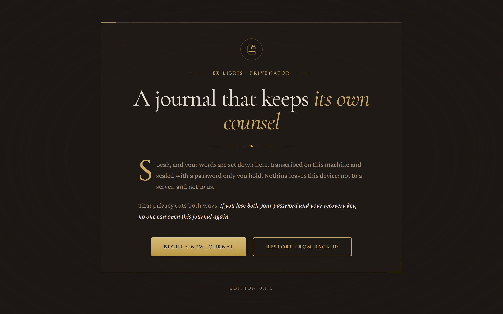</td>
    <td width="50%">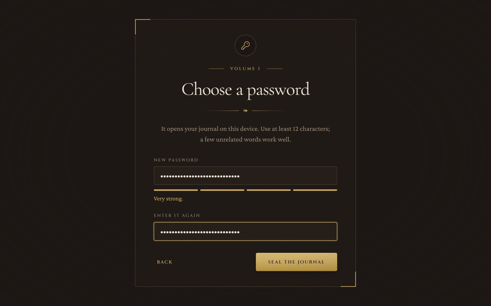</td>
  </tr>
  <tr>
    <td><b>Welcome.</b> Start a new journal, or restore one from a backup.</td>
    <td><b>Choose a password.</b> At least 12 characters, and the app checks its strength.</td>
  </tr>
  <tr>
    <td>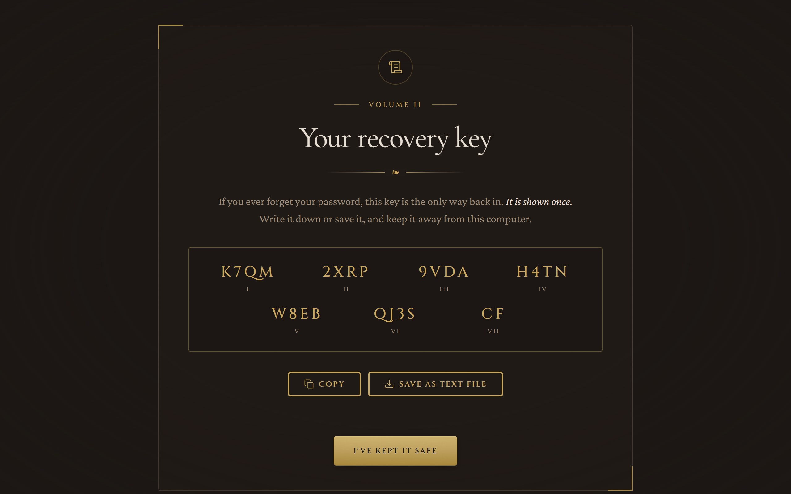</td>
    <td>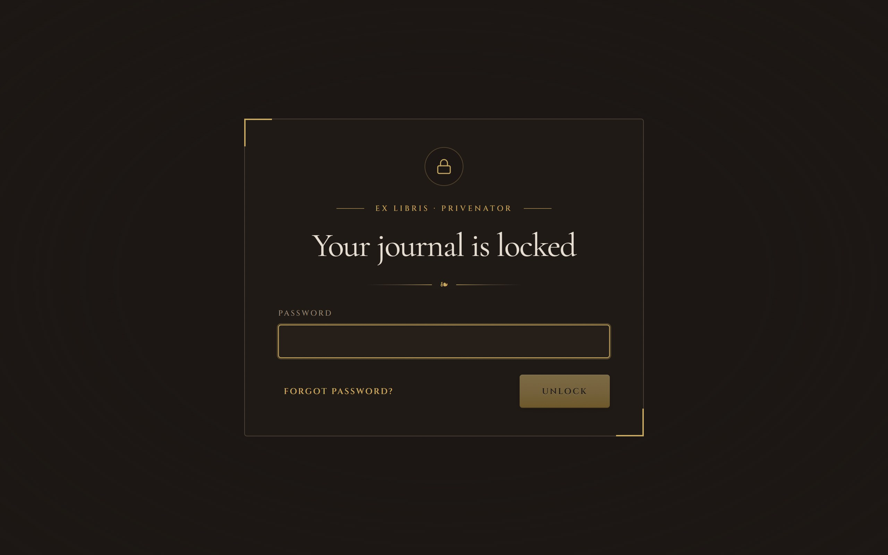</td>
  </tr>
  <tr>
    <td><b>Your recovery key.</b> Shown once. Copy or save it, then type two of the groups back to confirm.</td>
    <td><b>Unlock.</b> Wrong guesses add a growing delay.</td>
  </tr>
  <tr>
    <td>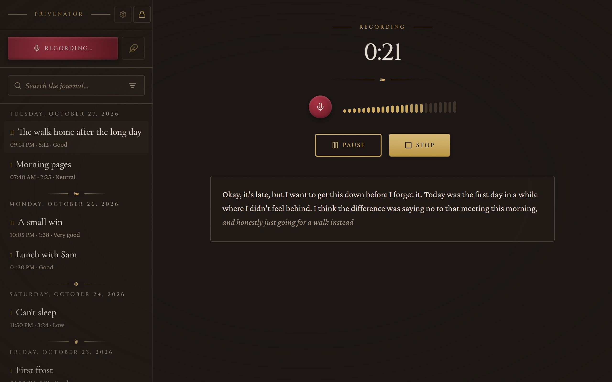</td>
    <td>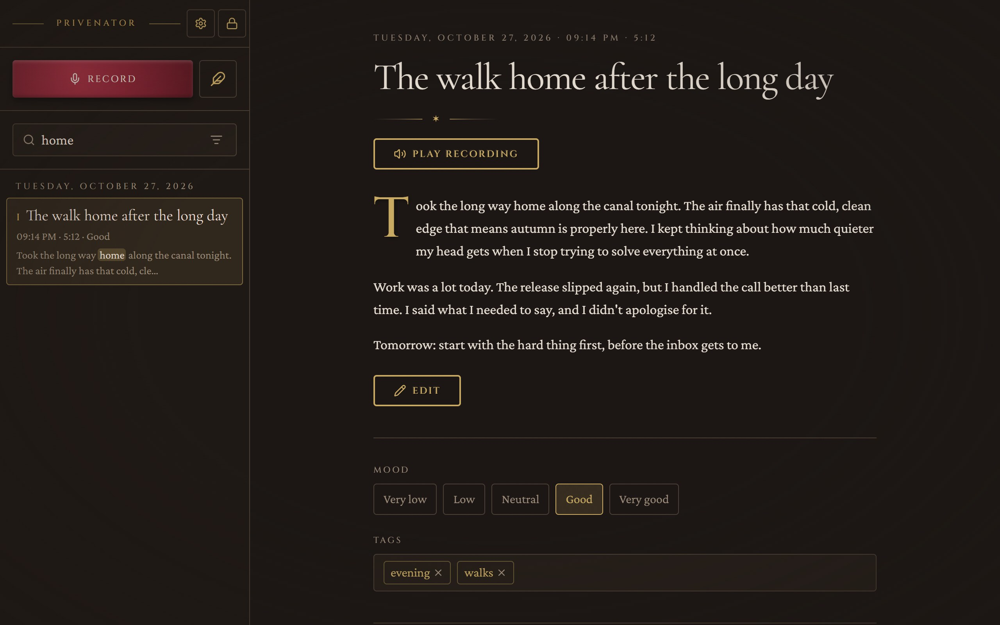</td>
  </tr>
  <tr>
    <td><b>Record.</b> Finished sentences appear in full. The part still being heard shows in grey italics.</td>
    <td><b>Search.</b> Matches are highlighted, and you can filter by mood, tag or date.</td>
  </tr>
  <tr>
    <td colspan="2">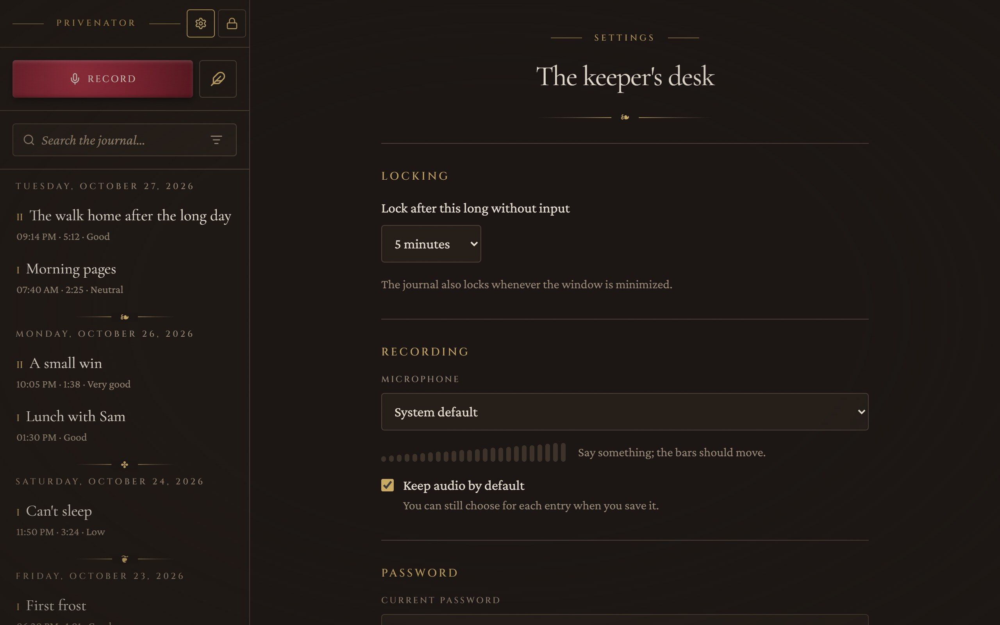</td>
  </tr>
  <tr>
    <td colspan="2"><b>Settings.</b> Auto-lock timeout, microphone, password and recovery key, backups and reminders.</td>
  </tr>
</table>

<sub>Screenshots show sample entries.</sub>

## How it works

<p align="center">
  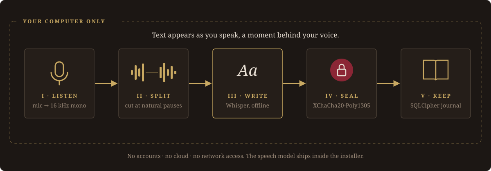
</p>

1. **Listen.** The microphone is recorded and converted to 16 kHz mono.
2. **Split.** A pause detector cuts your speech into sentences at natural breaks.
3. **Write.** [whisper.cpp](https://github.com/ggerganov/whisper.cpp) turns each piece into text on your CPU. A quick preview fills in while you're mid-sentence.
4. **Seal.** Each finished piece is encrypted the moment it's written. If the app crashes, the recording is recovered the next time you unlock.
5. **Keep.** When you stop, choose whether to keep the audio, add a mood and tags, and the entry is saved.

## Privacy and security

<p align="center">
  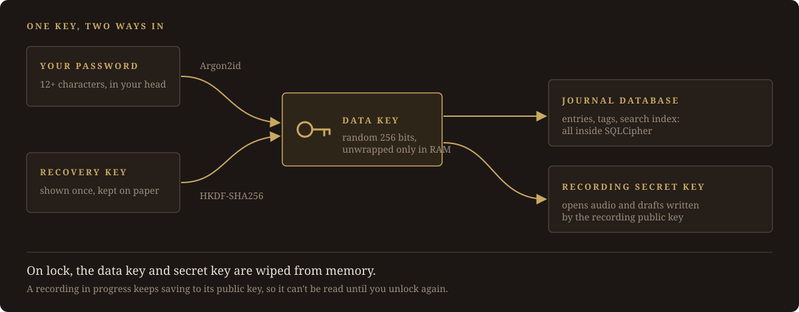
</p>

- **One data key, two ways in.** A random 256-bit key encrypts everything. Your password (stretched with **Argon2id**) or your recovery key (through **HKDF**) unlocks it.
- **Strong, standard encryption:** **SQLCipher** for the database, **XChaCha20-Poly1305** for audio and drafts, and **X25519** so a recording can keep saving while the journal is locked.
- **Wiped on lock.** Keys and on-screen text are cleared from memory whenever the journal locks.
- **Nothing to leak.** No network permissions, a strict content security policy, no crash dumps, and no journal text in logs.

**What it protects against:** anyone who gets hold of your computer or its files while Privenator is locked or closed.<br>
**What it doesn't:** malware or a keylogger already on your machine, or someone at your keyboard while the journal is open.

The full model is in [docs/SPEC.md → Security model](docs/SPEC.md#security-model).

## Status and roadmap

Privenator is at **v0.1.0, an early release**. Every feature listed above is built and covered by 43 automated tests, but the app hasn't had much hands-on use yet, so please [open an issue](https://github.com/Sodaguyprime/privenator/issues) if something breaks.

- [x] Encrypted vault, recovery key, auto-lock
- [x] Live transcription, crash recovery
- [x] Entries, editing, mood, tags, search
- [x] Encrypted backup and restore
- [x] Windows installer
- [ ] **Better voice processing** (accuracy, noise handling, speed). In progress.
- [ ] Code-signed installer
- [ ] macOS and Linux builds
- [ ] Android app that reads the same backups

## Build from source

You need Node 20+, stable Rust, the [Tauri prerequisites](https://tauri.app/start/prerequisites/), CMake and libclang. On Windows you also need [Strawberry Perl](https://strawberryperl.com/). [docs/ARCHITECTURE.md](docs/ARCHITECTURE.md) covers the full setup, including a Windows setup that doesn't need LLVM.

```sh
npm install
npm run fetch-model     # Whisper base.en (148 MB, checksummed), bundled into the app
npm run tauri dev       # run the app
cargo test --workspace  # Rust tests (two need the model)
npm run tauri build     # installers in target/release/bundle/
```

All the sensitive logic (crypto, audio, transcription, storage) lives in [`crates/journal-core`](crates/journal-core), a plain Rust crate with no Tauri dependency. `src-tauri` is a thin shell around it, and `src/` is the React UI.

## Documentation

| Doc | What's in it |
| --- | --- |
| [SPEC.md](docs/SPEC.md) | What the app does, the security model, file formats |
| [ARCHITECTURE.md](docs/ARCHITECTURE.md) | Code layout, the command API, the Android plan |
| [DESIGN.md](docs/DESIGN.md) | The visual design system |
| [DECISIONS.md](docs/DECISIONS.md) | Why things are the way they are |
| [PROGRESS.md](docs/PROGRESS.md) | Build status and known gaps |
